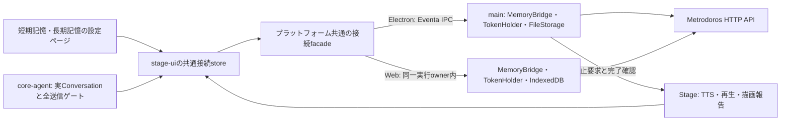

# 08.1. AIRI本体への組み込み・記憶設定UI

版：0.1／作成日：2026-10-28（日本時間）／状態：実装前の詳細設計。

正本：[設計08](08-airi-adapter.md) 第3・11・12節の具体化。配信・忘却の条件は同書第7・10・13節も引き継ぐ。
参照：[08実装契約](../implementation/08-airi-adapter-contract.md)、[アダプターの公開API](../../packages/airi-adapter/README.md)、[09](09-web-viewer-and-export.md)、[10](10-operations-and-verification.md)。

## 1. 完成している範囲と本書の目的

Metrodorosのdevelop `69a119e`には、PR #8のアダプター・永続outbox・サーバー契約が入っている。
AIRIの実会話、音声、設定画面へ接続するコードは未実装である。08のパッケージ試験成功をAIRI上の動作確認完了としない。
本書はこの残作業を08.1として定義する。09・10へ組み込みコードを先送りしない。

| 区分           | 対象                                                                                                              |
| -------------- | ----------------------------------------------------------------------------------------------------------------- |
| 08で実装済み   | `MemoryBridge`、`HostPorts`、`TurnDelivery`、ID対応、IndexedDB／desktop SQLite、SDK、能力確認、モデル対応版の固定 |
| 08.1で実装する | AIRIの送信境界、組立・起動停止、音声・描画の報告、通知の継続同期、記憶設定UI、配布用パッケージ化、実機試験        |
| 09に残す       | 記憶の一覧・検索・編集・訂正・忘却、根拠の管理画面、export/importの全機能                                         |
| 10に残す       | 常駐運用、OS秘密保管、バックアップ・復元、全体の故障・品質・性能評価                                              |

初回の実機対象は手元のWindows版AIRI `stage-tamagotchi`とIrodori通常pipelineとする。
共有UIとcore-agentはstage-webでも型・ブラウザー試験を通す。Webからの実HTTP接続はOrigin設定を検証してから有効化する。
本書の作成ではAIRIのソース、既存Irodori設定、個人プロファイルを変更しない。

## 2. 調査の基準

対象は`C:/Users/danie/AI/airi`の作業ツリー。上流HEADの調査結果ではない。
[調査時の基準](assets/08.1-airi-source-baseline.json)へ、HEAD、対象ファイルのハッシュ、ローカル変更の有無を記録する。
旧[08の調査記録](assets/08-airi-source-baseline.json)は2026-10-13時点の履歴として保持する。

現状から次の不足を確認した。

- `chat-orchestrator-runtime.ts`は実`Conversation`を構築し、別の表示用`composedMessage`を作る。後者の変更では送信内容は変わらない。
- Chat CompletionsとResponsesはSDK内部でツール往復する。`llm-service.ts`の一時障害再試行とstage-uiの互換再試行もある。
- `resolveStep`によるsystem promptの更新がある。初回の注入だけでは旧カード人格の再混入を防げない。
- speech busにはintentの送信・取消がある。チャンク配信結果と、指定outputの停止完了確認は不足する。
- `/settings/modules/memory-short-term`と`/settings/modules/memory-long-term`は`WIP`表示である。
- モジュール一覧の短期・長期記憶は`configured: false`固定である。
- 既存IOトレースはTTS本文を記録する。記憶連携時の本文除外が必要である。

既存のローカル改修にはIrodori、音声入力、Live2Dが含まれる。08.1実装前にその差分を保全する。
調査基準のハッシュは再調査用であり、未コミット変更を破棄する指示ではない。

## 3. 構成と所有者



`core-agent`は汎用の入力変換・送信許可・取消の契約だけを持つ。MetrodorosのSDKをimportしない。
接続facadeは設定ページ、会話leader、音声hostから共通利用する。設定ページごとにbridgeやoutboxを作らない。

Electronではmainが接続・token・永続outboxを所有する。rendererはEventaで型付き操作を依頼する。
`TurnHandle`はmainに保持し、rendererへは期限・owner付きの不透明な参照IDを返す。
`WeakMap`へ登録したhandleや`StoragePort.transact(fn)`の関数をIPCへ送らない。
rendererの取消signalは同じ参照IDへの取消要求へ変換し、mainの取消もrendererへ通知する。

Webでは同じfacadeを、会話の実行ownerにあるbridgeとIndexedDBへ接続する。
初版のtokenは入力後のメモリ内だけに保持する。再起動後は再入力する。平文の永続保存は追加しない。

## 4. 改修ファイルと責務

以下のAIRIパスはAIRIリポジトリ相対。「新規」は本書で提案する配置であり、実装済みファイルではない。

### 4.1 会話とprovider

| ID  | ファイル                                                                                                         | 必要な改修                                                                                     |
| --- | ---------------------------------------------------------------------------------------------------------------- | ---------------------------------------------------------------------------------------------- |
| C01 | `packages/core-agent/src/runtime/chat-orchestrator-runtime.ts`                                                   | 実Conversationの変換口、世代検査、取消・失敗を含む終端通知。表示投影の前に今回専用入力を確定   |
| C02 | `packages/core-agent/src/types/llm.ts`、runtimeの契約型・公開export                                              | 汎用の送信前検査と要求相関を追加。Metrodorosの型を公開契約へ混ぜない                           |
| C03 | `packages/core-agent/src/runtime/chat-completions.ts`、`responses.ts`                                            | ツール往復・native continuation・system prompt再構成への適用。SDKの実送信fetchを検査可能にする |
| C04 | `packages/core-agent/src/runtime/llm-service.ts`                                                                 | 一時障害再試行、protocol切替の各物理送信でゲートを維持。拒否を再試行可能な通信障害へ変換しない |
| C05 | `packages/stage-ui/src/stores/ai/chat-llm/llm.ts`                                                                | content-array互換再試行へ同じゲートと取消を渡す。副作用済みツールを再実行しない                |
| C06 | `packages/stage-ui/src/stores/chat.ts`                                                                           | bridgeの組立口、固定したカード・world・モデル・生成試行ID、leader経由の実行と取消を接続        |
| C07 | `packages/stage-ui/src/stores/modules/airi-card.ts`、`stores/character/index.ts`、`stores/chat/session-store.ts` | 人格の出所分離、カード切替、旧sessionの扱い、アプリ指示とカード人格の二重注入防止              |
| C08 | `packages/stage-ui/src/stores/chat/image-projection.ts`と画像読取経路                                            | 除外済み履歴・添付・tool結果をvision用要求からも除外。補助モデルへの送信も取消・世代に束縛     |

### 4.2 接続・永続化・停止

| ID  | ファイル                                                                                              | 必要な改修                                                                                         |
| --- | ----------------------------------------------------------------------------------------------------- | -------------------------------------------------------------------------------------------------- |
| H01 | `packages/stage-ui/src/services/memory/connection.ts`、`contracts.ts`（新規）                         | プラットフォーム共通facade。prepare、gate、progress、配信、取消、設定、状態を一つの契約へ集約      |
| H02 | `packages/stage-ui/src/stores/modules/memory.ts`（新規）                                              | 両設定ページが共有する設定・状態store。token・本文・bridgeの実体は同期storeの保存対象にしない      |
| H03 | `apps/stage-tamagotchi/src/main/services/airi/metrodoros/index.ts`（新規）                            | mainのbridge、FileStorage、通知・outboxタスク、owner管理、終了時の停止                             |
| H04 | `apps/stage-tamagotchi/src/shared/eventa/metrodoros.ts`（新規）、`src/preload/`、rendererのbridge登録 | 型付きIPC、ownerと参照IDの照合、取消・停止確認。任意URL・任意ファイル・関数を実行するRPCを作らない |
| H05 | `apps/stage-tamagotchi/src/main/index.ts`と既存DI登録                                                 | 外部境界として接続サービスを登録。実ElectronのNodeと`node:sqlite`利用可否を起動時試験で確認        |
| H06 | `apps/stage-web`の起動処理とmemory接続factory                                                         | Web用IndexedDB・メモリtoken・Origin検査済み通信を登録。desktop専用exportをbrowser bundleへ入れない |
| H07 | `packages/stage-ui/src/services/speech/bus.ts`、`pipeline-runtime.ts`、`stores/speech-runtime.ts`     | 配信結果の返送、output単位の停止要求・確認、host交代時の未確定扱い                                 |

### 4.3 配信・表示・計測

| ID  | ファイル                                                                                               | 必要な改修                                                                        |
| --- | ------------------------------------------------------------------------------------------------------ | --------------------------------------------------------------------------------- |
| D01 | `packages/stage-ui/src/components/scenes/Stage.vue`                                                    | 実TTS要求、合成、再生開始・終了・中断を接続。Irodoriの分割設定を保持              |
| D02 | `packages/pipelines-audio/src/speech-pipeline.ts`、`types.ts`                                          | 全TTS要求の列挙完了と、キュー・合成・再生の停止確認を区別できる汎用イベントを追加 |
| D03 | `packages/pipelines-audio/src/managers/playback-manager.ts`                                            | 正常終了・中断・拒否の意味を回帰試験で固定。必要なoutput相関を伝える              |
| D04 | `packages/stage-ui/src/components/scenarios/chat/components/assistant-item.vue`と履歴表示経路          | final本文のDOM反映後に一度だけ描画報告。stream placeholder更新を表示完了としない  |
| D05 | `packages/stage-ui/src/composables/use-io-trace-bridge.ts`、`stores/devtools/context-observability.ts` | 記憶付きprompt・TTS本文を通常のトレース・plugin向け投影から除外。時間と件数を表示 |
| D06 | `apps/stage-tamagotchi/src/renderer/bridges/io-trace-recording.ts`、mainの`io-trace-recording`         | ファイル保存側でも本文・tokenの混入を検査。rendererだけの非表示で済ませない       |

### 4.4 設定UI

| ID  | ファイル                                                                | 必要な改修                                                                  |
| --- | ----------------------------------------------------------------------- | --------------------------------------------------------------------------- |
| U01 | `packages/stage-pages/src/pages/settings/modules/memory-short-term.vue` | `WIP`を短期記憶の設定・状態表示へ置換                                       |
| U02 | `packages/stage-pages/src/pages/settings/modules/memory-long-term.vue`  | `WIP`を長期記憶の設定・状態表示へ置換                                       |
| U03 | `packages/stage-ui/src/components/scenarios/settings/memory/`（新規）   | 共通接続フォーム、状態表示、カード対応、人格承認、モデル対応を部品化        |
| U04 | `packages/stage-ui/src/composables/use-modules-list.ts`                 | 短期・長期の`configured: false`固定を、実際の設定・対応状態からの判定へ変更 |
| U05 | `packages/i18n/src/locales/en/settings.yaml`、`ja/settings.yaml`        | 表示・説明・エラー・確認操作を追加。実装時はi18nのAGENTSを適用              |

### 4.5 Metrodoros側に必要な補足

| ID  | ファイル                                                                                                    | 必要な改修                                                                                     |
| --- | ----------------------------------------------------------------------------------------------------------- | ---------------------------------------------------------------------------------------------- |
| M01 | `packages/airi-adapter`、`packages/client`、`packages/contracts`のpackage定義・build/export                 | private・TS source export・隣接package相対importの現状から、AIRIへ持ち込める版付き成果物を作る |
| M02 | `apps/server/src/http/airi-connection.ts`（新規）、`http/app.ts`、`packages/contracts/src/airi.ts`、対応SDK | 再接続時のclient識別を検証する追加契約。第9節に定義                                            |
| M03 | `packages/airi-adapter/src/bridge.ts`と通知同期の公開契約                                                   | 通知の同期・ACKをoutbox全件送信から分離。通知ループが大量の再送を待ち続けない口を追加          |

既存の記憶順位、忘却閉包、整理アルゴリズムをAIRIへ移植しない。新しい記憶DBもAIRI側に作らない。
FileStorageのファイルはアダプターのoutbox専用であり、Metrodoros正本DBとは別物である。

## 5. 実Conversationと送信ゲート

### 5.1 入力の組立

core-agentの汎用変換口へ、実Conversation、session、user message、生成試行、選択世代、取消signalを渡す。
transformは現在入力・添付・アプリ上位指示の構築後、preview・plugin通知・最初のprovider送信より前に実行する。
戻り値は今回専用Conversationと実行文脈の参照ID、または送信保留である。

stage-uiが`MemoryBridge.prepareRequestContext`へ適合させる。`disabled`でも返されたConversationを使用する。
`blocked`では送信しない。`degraded`はアダプターが返した内容だけを送り、元の履歴へ戻さない。
変換済みConversationをsession repositoryや永続context registryへ保存しない。

現在のカード由来system promptを、丸ごと「アプリ上位指示」と認定しない。
カード人格とAIRI実行規則・tool規則の出所を分離する。生成時のIDと出所を固定して`isAppInstruction`へ適合させる。
未分離の既存sessionは記憶連携用の新sessionへ移る。旧履歴の閲覧と、LLMへ再送する履歴を区別する。

### 5.2 全送信の検査

| 実送信                                | gate種別        | 保持するもの                             |
| ------------------------------------- | --------------- | ---------------------------------------- |
| 最初の要求                            | `initial`       | prepareで登録した同じoutputと送信期限    |
| ツール結果を使う次の要求              | `continuation`  | 同じ生成試行・output・signal             |
| 408/429/5xx・互換形式による自動再試行 | `retry`         | 同じ生成試行。ユーザー再生成と区別       |
| ユーザーの明示再生成                  | 新しい`initial` | 同じuser messageでも新しいattempt/output |

検査はSDKの実送信fetch境界まで届かせる。`prepareStep`や`llm.stream`の入口だけで全送信対応済みとしない。
provider固有fetchを保持したwrapperを使い、SDK内部の再試行も通す。provider設定更新後もwrapperを外さない。
gate拒否・通知断・世代不一致は終端とし、別protocolや互換再試行へ逃がさない。
許可後、実送信直前にsignalと選択世代を再検査する。

メモリ付き試行ではprovider/modelと対応版を固定する。`resolveStep`が別モデルを要求したら現在試行を停止する。
次の明示試行で新しい対応を取得する。古い対応で新モデルへ送信しない。
継続時のsystem prompt再構成でも、変換済み人格・記憶を維持し、旧カード人格で上書きしない。
現在試行で実行したtool結果は対を保つ。想起や履歴選択を毎tool往復でやり直さない。

初回対応は検証したChat Completions／Responses経路に限定する。
native continuationの除去、内部再送の検査を保証できない接続先では記憶連携を有効化しない。
visionなど補助モデルへ記憶を含む本文を送る場合も同じ取消・失効境界へ束縛する。

### 5.3 待ち時間

AIRI側の前処理開始から、IPCと保存待ちを含む共通1,000msを測る。想起は最大900msとする。
mainのadapter内部計測だけを追加待ちとして報告しない。ホスト側にも全体期限と取消を設ける。
期限後のprepare応答・gate許可は破棄し、mainの同じ試行も取消する。遅い結果で後から送信しない。
各継続要求の検査も1,000ms以内とし、失敗時に予算を再発行して待ち続けない。

## 6. ID、leader、カード切替

固定するキーは`airiSessionId`・`userMessageId`・`attemptId`・`selectionGeneration`とする。
AIRIの文字列IDをUUIDとして扱わない。UUID変換と採番は既存アダプターへ任せる。
音声の`intentId`・`streamId`・`segmentId`を同じ生成試行へ対応させる。

会話leaderが生成を実行し、音声hostが再生を担当する。mainは両者のowner世代を管理する。
leader交代時は旧要求を止め、同じ保存領域とwriter継承を検証してから新ownerを接続する。
共有保存領域を証明できない別windowは独立sessionとする。
設定windowを開くだけで、新しい会話writerを作らない。

カード・world・接続先・tokenの変更は、旧出力停止→旧session終了→選択世代更新→新接続同期の順とする。
古いPromise・音声イベント・描画イベントは、元の参照IDへだけ適用する。現在カードへ付け替えない。
参照IDはownerと世代に束縛し、終了後の再利用を拒否する。

## 7. 配信と停止の報告

| 観測した事実                      | 既存アダプターへの操作                                             |
| --------------------------------- | ------------------------------------------------------------------ |
| 実TTS要求の確定文                 | `delivery.ttsRequest(key, text)`                                   |
| 合成結果                          | `ttsResult`。成功でも配信完了にしない                              |
| 正常な再生開始／終了              | `playbackStart`／`playbackEnd`                                     |
| 再生中断／拒否                    | `playbackInterrupt`／`playbackFail`                                |
| 当該試行の全TTS要求を生成し終えた | `speechRequestsComplete`                                           |
| LLMの正常終了                     | `llmFinished('completed', fullText, assistantMessageId)`           |
| final本文が描画された             | `displayed`。未描画なら`displayUnavailable`                        |
| intent終了／取消                  | `intentEnd`／`intentInterrupted`                                   |
| ミュート・noop・未対応経路        | `audioUnavailable`。必要な停止を先に確認                           |
| 生成途中の取消・失敗              | 部分本文を`recordProgress`へ反映し、取消・失敗の終端を一度だけ保存 |

`onChatTurnComplete`だけでは取消・失敗を拾えない。runtimeのsettled経路を追加で接続する。
`onIntentEnd`は全文の再生完了ではない。既存pipelineには再生待ち中のintent終了もある。
TTS要求の列挙完了は、最終flush後に未列挙要求がなくなった時点で発行する。
LLMが終わっても、配信結果が確定する前に`releaseTurn`や出力stateの終端報告を行わない。

speech busで別windowへ返す結果は、相関ID・種別・時刻・状態を基本とする。
TTS確定文は生成イベントのために接続ownerへ一度渡すが、汎用broadcastや通常ログへ複製しない。
Irodoriの`minChars:30 / maxChars:50 / sentences:2`、音量、voice、参照音声を変更しない。
詳細120チャンク超過、streaming専用経路、host消失では完了を推測しない。

停止要求には、生成、合成中、待機中、再生中を含むoutput単位の相関を付ける。
`speaking:false`という全体状態だけでは停止確認に使わない。対象のqueueが空で、新規enqueueも禁止済みであることを確認する。
音声hostから応答がない場合は停止未確認とし、忘却ACKを返さない。

## 8. 通知・再接続・永続化

通知は設定ページの開閉に依存させず、接続ownerの生存中に同期する。
07の変更API・SDKを使い、同期の並列実行を防ぐ。待機方式は既存HTTP契約内で構成する。
通信失敗、owner消失、同期停止を検知したら`notificationDisconnected`を呼び、既存出力を停止する。

順序は変更取得→ローカル無効化→生成・音声停止確認→ACK→checkpoint保存→期限内outbox再送とする。
ACK成功前に同期済みと表示しない。outbox全件の再送待ちで次の変更取得を止めない。
M03では通知同期と送信タスクの分離を実装し、途中に忘却が来る大量outboxの試験を追加する。

Electronの保存先はAIRIのuserData配下の専用領域とする。正本の`metrodoros.sqlite`を直接開かない。
Webのnamespaceはインストール、検証済みclient、接続先から分ける。token本文をキーへ入れない。
再接続時に別client・別正本と判定したら旧領域を停止し、新しい領域へ分ける。旧本文を新しい認証へ再送しない。
renderer強制終了・main再起動後も、元のevent ID・番号・本文・冪等キーを保持する。

## 9. 接続の識別とパッケージの追加契約

### 9.1 認証したclientの識別

現在の`GET /v1/airi/capabilities`は能力を返すが、再接続先の認証clientの識別情報を返さない。
M02では認証済みの`GET /v1/airi/connection`を追加する。必要権限は`identity:read`、queryとbodyは受け付けない。
下記は追加予定の応答であり、現行APIの応答ではない。

```json
{
  "user_id": "10000000-0000-4000-8000-000000000001",
  "client_id": "10000000-0000-4000-8000-000000000002",
  "store_generation": "10000000-0000-4000-8000-000000000003"
}
```

値はrequestの認証principalと、起動時に検証済みの正本世代から生成する。クライアントの自己申告値を返さない。
既存capabilitiesの応答は保持する。追加APIのDTO・SDK・HTTP試験を同じ変更単位で実装する。新しいDB migrationは不要とする。
秘密、token、他clientの一覧、内部ファイルパスは返さない。Host・Origin・認証失効の検査は既存APIと共通にする。
08.1はこの識別を確認できたサーバーを接続対象にする。401/403、失効client、未知世代では旧outboxを再送しない。
これは公開契約への識別情報追加であり、AIRIのcore-agentにclient IDを埋め込む変更ではない。

### 9.2 AIRIへ導入する成果物

現在の3パッケージはprivateで、TS sourceと隣接packageの相対参照を使う。
M01ではJS・型定義・exportsを整え、AIRIのworkspace外でも解決できる版付き成果物を作る。
版番号、Metrodoros commit、成果物のSHA-256を記録し、AIRIのlockfileへ固定する。
ローカル試用はAIRI内のvendor領域へ置く相対tarball参照を許す。利用者PCの絶対パス依存を配布へ残さない。
公開registryへのpublishは08.1の前提にしない。

browser用exportへ`node:sqlite`を含めない。desktop用はmainで読み込み、実Electron同梱NodeでSQLiteの保存・rollback・再起動を確認する。
開発用Node 26やMetrodoros用Node 24の成功を、Electron内での成功の代わりにしない。
必要なAPIがないElectronでは接続を無効にして理由を表示し、MemoryStorageへ自動退避しない。

## 10. 既存の短期記憶・長期記憶ページを使う設定UI

ユーザー指定により、設定画面の既存2ページを完成させる。
新しい独立した「Metrodoros設定」ページは作らず、両ページが同じ接続profileを参照する。
既存`/settings/memory`ページは09の管理機能と混同させず、この2ページへの案内に限定する。

### 10.1 共通の接続欄

共通部品を両ページへ配置する。片方で保存した非秘密設定はもう片方にも反映する。

| 項目           | 操作・表示                                                                                  |
| -------------- | ------------------------------------------------------------------------------------------- |
| 接続先         | 初期値`http://127.0.0.1:47831`。08.1の実機試験はloopbackの正本へ接続                        |
| 接続token      | マスク入力、メモリ内保持、再入力・破棄。カード、localStorage、同期store、exportへ保存しない |
| 接続確認       | healthだけで成功にしない。認証、能力、client識別、必要な停止口、初期通知同期を検査          |
| 記憶連携ON/OFF | 共通の一つの設定。どちらのページでも同じ値を表示。OFF時も除外と停止を完了させる             |
| 状態           | 接続済み／記憶を使わず会話／整理待ち／同期が必要／保存できていない／記憶連携オフ            |
| 詳細           | 認証client、正本世代、未送信件数、最終同期、能力不足。本文・tokenを含めない                 |

画面の保存と有効化を区別する。接続検査に失敗しても入力した非秘密設定は保持できる。
能力のbooleanをUIから手動で真にして有効化しない。実装・試験済みの経路が能力を決める。
接続先やtokenの変更は、旧接続を停止することを操作前に説明する。

### 10.2 短期記憶ページ

上から共通接続欄、現在の会話、同期・保存状態、会話操作の順に配置する。

- 現在のカード、Metrodorosキャラ、world、連携sessionの状態を表示する。
- 「新しい会話を開始」は旧試行停止とsession close後に実行する。長期記憶の削除操作にしない。
- 履歴上限8ターン・6,000文字、原会話7日、観測60秒は現行の規則として表示する。
- 上限と保持期間は読み取り専用とする。現在のAdapterSettingsにない変更フォームを作らない。
- 未送信件数、保存不能、再接続、同期再試行を表示する。破棄や再送先変更を通常の再試行に混ぜない。
- 観測の利用状態は表示する。08.1で新しい画面キャプチャの同意・収集機能を追加しない。

### 10.3 長期記憶ページ

上から共通接続欄、カードと人格、会話モデル対応、整理状態、管理画面への案内の順に配置する。

- AIRIカードとMetrodorosキャラを対応付ける。新規キャラ作成と既存キャラ選択を区別する。
- 人格移行は候補表示→本人の承認→登録の2段階とする。再読込で勝手に登録しない。
- `PersonaMigration`の候補digestと承認を使う。実行規則やtool権限を人格へ混ぜない。
- provider/modelと`external_profile_id`、binding/profile版を対応付ける。APIキーをコピーしない。
- 対応不明・競合は「整理待ち／モデル対応を確認」と示す。入力保存成功を整理完了と表示しない。
- 整理待ち件数は06 APIから取得する。取得できない値を0件と表示しない。
- 記憶の編集・忘却・export/importは09の管理画面へ案内する。09未提供時は利用可能な機能だけを示す。

現行bridgeには短期・長期を個別に無効化する設定がない。
08.1では共通の連携ON/OFFを使い、片方だけ止められると見せない。
短期ページの会話履歴と、長期ページの人格・モデル対応は用途の異なる設定として分ける。

### 10.4 UIの受け入れ

両ページの`WIP`表示を置換し、既存モジュール一覧のリンクを維持する。
`configured`は設定と必要能力から導出する。通信中のready状態と同一のbooleanにしない。
token再入力が必要な再起動後は、その状態を明示する。
日本語と英語、キーボード操作、ラベル、エラーとの対応、両window間の設定反映を確認する。
設定画面の見た目・対話はAIRIの`DESIGN.md`と既存部品へ合わせる。

## 11. 計測・本文の保護

表示する値は`memory_recall_ms`、`memory_validate_ms`、ホスト側を含む`memory_total_ms`、`outbox_pending`、`consolidation_pending`とする。
LLM初文字・生成終了、TTS生成、最初の再生開始、再生待ちを別に記録する。
通常の記憶連携ではprompt、参照記憶、TTS本文、画面観測本文、tokenをIOトレース・plugin通知・診断exportへ残さない。
通常の会話本文を必要な表示・既存履歴へ保存する処理と、注入内容の診断保存を区別する。
詳細本文を確認する試験では、本人が一時的に有効化し、終了時に停止・消去する。
合格証跡へは匿名fixture、相関ID、送信件数、状態、時間を残す。私的な会話や音声素材を記録しない。

## 12. 実装順と完了条件

| 段階 | 作業                                                                             | 完了の判定                                                 |
| ---- | -------------------------------------------------------------------------------- | ---------------------------------------------------------- |
| P0   | 調査基準更新、ローカル差分保全、AIRIルール再確認、パッケージ化、Electron適合試験 | 版固定した成果物を両appで解決できる                        |
| P1   | main／Webのfacade、ID・client識別、永続化、通知とoutbox分離                      | 無注入で再起動・再送・owner交代が通る                      |
| P2   | 汎用transform、人格分離、全provider gate、本文なし投影                           | 一件の明示記憶が実送信に一度だけ入り、失効後に再送されない |
| P3   | TTS・描画・取消・停止確認、忘却ACK                                               | 中断を完了にせず、停止確認前にACKしない                    |
| P4   | 既存の短期記憶・長期記憶ページ、設定共有、人格承認、モデル対応                   | UI操作だけで接続・対応付け・開始・停止・再接続できる       |
| P5   | 実LLM・Irodori、両app回帰、上流更新用試験                                        | 下表と設計08のAIRI-01〜14を通す                            |

08.1完了はP0〜P5の完了とする。P2だけのデモや、設定UIだけの完成で全体完了にしない。
09の全管理UI、10の復元機能が未実装でも、一キャラの実接続試験を実施できる構成にする。

## 13. 試験台帳

| ID     | 試験                                      | 合格条件／元の条件                                                                                     |
| ------ | ----------------------------------------- | ------------------------------------------------------------------------------------------------------ |
| A81-01 | 実provider payloadの捕捉                  | 公開Conversation型との適合、記憶一件・人格・現在入力が一回だけ。原本不変。AIRI-01/02                   |
| A81-02 | Chat Completions／Responsesのtool往復     | 全物理送信がgateを通る。失効後の呼出件数0。AIRI-08/11                                                  |
| A81-03 | 一時障害・互換再試行・protocol変更        | 既存outputを検査。拒否後の別経路再送0。副作用ツール重複0                                               |
| A81-04 | カード人格・`resolveStep`・モデル切替     | 二重人格なし。モデル対応を無断差替えしない。AIRI-04/12                                                 |
| A81-05 | IPC遅延・想起遅延・遅い成功               | ホスト側1,000msで保留または許可された縮退。遅延結果で送信しない。AIRI-09                               |
| A81-06 | leaderと音声hostが別window                | 同じ相関へ報告。旧ownerの報告とwriter再利用を拒否。AIRI-03                                             |
| A81-07 | Irodoriの2チャンク目途中停止              | 最初だけ正常完了、全文配信済みにならない。AIRI-05/06                                                   |
| A81-08 | ミュート・noop・合成失敗・未対応streaming | audio completedを捏造しない。描画は独立。AIRI-07                                                       |
| A81-09 | LLM終了後に遅れてTTS要求、描画失敗        | 列挙完了・実配信の前にfinal集合やoutput終端を確定しない                                                |
| A81-10 | 忘却中の生成・再生・大量outbox            | 旧本文を除外し、停止確認後だけACK。通知同期が再送に阻まれない。AIRI-08/10                              |
| A81-11 | renderer強制終了、main再起動、再認証      | 保存済み採番・冪等キーを復元。異なるclientへ旧本文を送らない                                           |
| A81-12 | 短期・長期ページの操作                    | 開発中表示なし、共通設定一致、token非永続、承認なし人格登録0                                           |
| A81-13 | トレース・カード・設定・exportの検査      | 注入記憶・token・無許可本文の混入0。AIRI-13                                                            |
| A81-14 | 上流接続点の変更を模擬                    | 実Conversation・gate・再生契約の破壊を検知。AIRI-14                                                    |
| A81-15 | 実会話→整理→別sessionの想起               | 実モデルの整理完了後に同じキャラで想起。別キャラには混ざらない。OPS-02/03                              |
| A81-16 | WebのOrigin、Electron、成果物単独導入     | 任意Originを許可しない。bundleに絶対パス・browser側Node専用依存なし                                    |
| A81-17 | 接続識別APIの認証・失効・入力検査         | 本人のprincipalと正本世代だけを返す。失効clientを拒否し、query/bodyは422。既存capabilitiesの応答を保持 |

core-agentの単体試験、stage-uiとstage-pagesのブラウザー試験、Electronの実IPC試験を分ける。
Metrodorosの実HTTP・SQLiteを使う結合試験では、権限・忘却・コミットをmockへ置き換えない。
実機では「紅茶が好き」と伝え、整理job完了後に新sessionで確認し、続いて訂正・忘却・再起動を試す。
LLMが「覚えた」と返しただけでは合格にしない。実送信、保存状態、配信結果で判定する。

実装時は各workspaceのtypecheckと関連試験、共有export変更時のAIRI root typecheck、lintを実行する。
`stage-tamagotchi`と`stage-web`のbuild、Metrodorosの`pnpm check`、既存独立検証、frozen guardを通す。
既存のテスト本文・期待値・期限・coverage基準を緩めて合格にしない。

## 14. 成果物と実装時の注意

成果物は両repoの改修、版固定した接続package、短期・長期設定UI、試験台帳、起動・設定・動作確認の手順とする。
MetrodorosとAIRIは別の変更単位としてレビューし、相互に必要な版を記載する。
実装着手時にAIRIのAGENTS・TypeScript・Vitest・Pinia・UI・i18n・PRルールを再確認する。
既存受け入れテストとIrodori・Live2D・音声入力の差分を保全する。
本書には未実装のファイルと追加契約がある。設計書の追加を、そのコードやAIRI実機の完成として報告しない。
